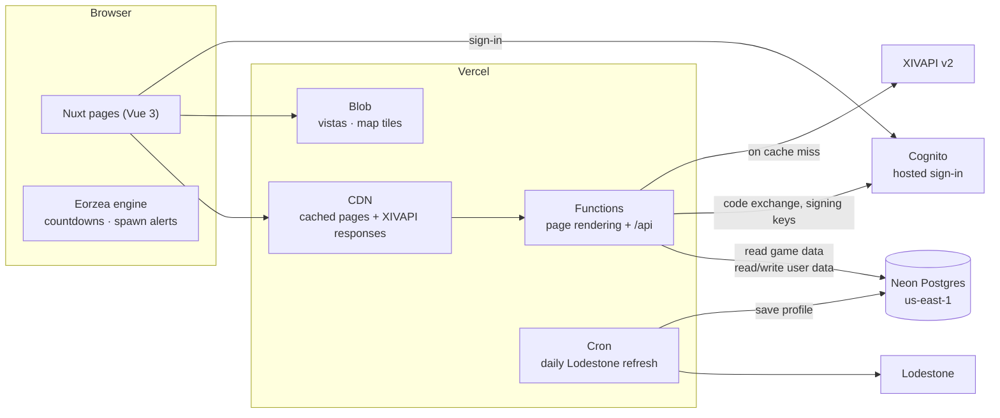
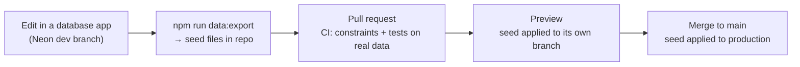

# FFXIV Radar — Architecture (design phase)

**Status:** decisions complete as of 2026-10-10. Nothing is built yet. Next step: the database
schema, designed together. This doc overrides `project-outline.md` wherever they conflict.
Hostinger was considered for hosting and dropped: its cPanel plan couldn't run Node.

**Superseded in `project-outline.md`:**
- Guiding principle #5: game data now lives in Postgres, not JSON files.
- Tech stack rows: Game reference data, User accounts & sync, News, and Images/CDN.
- The whole News section: it's now markdown files, not DynamoDB.
- The DynamoDB data model.
- Every mention of S3, DynamoDB, or IAM-scoped AWS credentials.

---

## Decisions

### Platform

| Area | Decision | Why |
|---|---|---|
| Hosting | **Vercel**, for production and previews. Hobby now, Pro later | Native Nuxt support, the DNS is already there, a preview per PR, no servers to run. |
| Server region | **US East**: Vercel `iad1` + Neon AWS `us-east-1` | Vercel's default. Functions sit next to the database. Cached pages are served worldwide anyway. |
| Ads | **Google AdSense**, behind a per-environment switch, **off until Pro is active** | Vercel Hobby forbids ads. Ads are never shown on previews or staging. |
| Analytics | **Vercel Web Analytics** | Built in and cookie-free. The old site already uses it. |
| Repo and CI | **GitHub + GitHub Actions** | Lint, type checks and tests on every PR. |

### Application

| Area | Decision | Why |
|---|---|---|
| Framework | **Nuxt (Vue 3)**, TypeScript `strict` | Server-rendered HTML for search engines. One app serves both pages and API. |
| Server code | **Nuxt server routes** (`server/api/`) running as Vercel Functions | Same language and shared types on both ends. |
| State | **Composables**, adding Pinia only if needed | Logic stays testable outside components. |
| Styling | **SCSS + design tokens**, exposed as CSS custom properties | Familiar, and one source of truth for colors and spacing. |
| Map | **Leaflet** | Raster game maps with layered markers. |
| Game engine | **`packages/domain`**, framework-free, ported from old `hooks.ts` with its tests | The hardest logic, tested in isolation. Runs in both browser and server. |
| Validation | **Zod** at every server boundary | Rejects bad requests and bad external-API responses. |
| Tests and quality | **Vitest + Vue Test Utils**, **ESLint + Prettier**, pinned Node (`.nvmrc` + `engines`) | Part of CI from the first commit. |

### Data

| Area | Decision | Why |
|---|---|---|
| Database | **Postgres on Neon**, via the Vercel Marketplace | SQL with enforced links between tables. Free tier. A database branch per preview. Easy to move to AWS later. |
| Database library | **Drizzle**: schema, migrations and typed queries | One tool, Neon support, parameterized queries. |
| Game data | **Read-only for the site.** Changes only arrive through deploys (see "Editing game data") | Mistakes are caught in review and on previews, not in production. |
| IDs | **The game's own IDs** (item, gathering point, fishing spot, etc.) | They never change, synced tracking relies on them, and XIVAPI looks things up by them. |
| External data | **XIVAPI v2**, called by our server and cached on Vercel's CDN. **Never stored in the database** | The site keeps working if XIVAPI is slow or down. Visitors never contact XIVAPI. |
| Datasets | **All of them**: gathering (mining, botany), fishing, sightseeing, aether currents, Blue Mage, weather, areas, plus elite hunts, FATEs, aetherytes and the Gold Saucer GATE timer | Schema to be designed together. The GATE timer is computed from the clock, so it needs no data. |
| Languages | **English at launch**, structured so JP/DE/FR can be added without restructuring | XIVAPI can supply other-language names by game ID. |
| Item pages | **A page per item** (e.g. `/fishing/<slug>`), alongside the tables | Search traffic, with cheap cached rendering. |
| Images | **Vercel Blob** for vistas, map tiles and large art. Small UI icons ship with the app | Keeps images out of git and out of deploys. |

### Accounts and features

| Area | Decision | Why |
|---|---|---|
| Login | **AWS Cognito, hosted sign-in page**: Email + password, Google, Facebook | Passwords never touch our server. Reset and verification are built in. No site data is stored in AWS. |
| Synced to account | **Tracked nodes + checklist progress** (Aether Currents, Blue Mage, Sightseeing) | Preferences stay in the browser's `localStorage`. |
| Logged out | Tracked nodes and checklists in `localStorage`, merged into the account on first login | Login is optional. Nothing is lost when signing up. |
| Spawn alerts | **In the browser only**, while a site tab is open | No backend needed. Push notifications could come in a later version. |
| News | **Markdown files in the repo**, published with deploys | Posts are release notes anyway. No admin page, table or admin group. |
| Lodestone profile | **A daily scheduled job** (Vercel Cron) saves the character to Postgres, and the page reads it from there | One fetch a day. Visitors never trigger a Lodestone request. |

---

## System overview



**Pages are rendered from Postgres and cached on Vercel's CDN** (Nuxt `routeRules` with `isr`).
- Google gets full HTML.
- The database sees a few queries per page per cache period, not one per visitor.
- Static pages (Home, About, Privacy, News) are prerendered at build time.

**Countdowns and alerts run in the browser.** The engine ticks every second against the visitor's
clock, so each page sends every node's spawn conditions (time windows, weather) to the browser
along with the rendered HTML.

### What writes to the database

| Data | Written by |
|---|---|
| Game data | **Only deploys**, from seed files in the repo |
| Tracked nodes, checklist progress | Signed-in users, through the API |
| Lodestone profile | The daily scheduled job |
| XIVAPI responses | **Never.** Cached on Vercel's CDN instead |

---

## Editing game data



- **The dev branch is your editing workspace.** Use any Postgres app: Neon's console, TablePlus,
  DBeaver, etc.
- **Export:** the script writes every game-data table to seed files in `packages/db/seed/`, so each
  change appears as a readable diff in the PR.
- **Applying a seed:** rows are matched by game ID, so re-applying the same seed changes nothing.
  Rows removed from the seed are removed from the database, and all of it happens in a single
  transaction.
- **Tests run against the real data,** the same way the old engine tests ran against the real JSON.

---

## Code layout

```
apps/web/              Nuxt app: pages, components, server/api routes (Vercel project root)
apps/web/content/news/ News posts as markdown
packages/domain/       Eorzea time/weather/window engine, framework-free
packages/db/           Drizzle schema, migrations, queries, seed files, export/apply scripts
```

---

## Environments

| Environment | URL | Database | Cognito user pool | Ads |
|---|---|---|---|---|
| Local | `localhost` | Neon `dev` branch | dev | off |
| Preview (every PR) | random `*.vercel.app` | Its own Neon branch from `dev`, with the PR's seed applied | dev (sign-in doesn't work here, see below) | off |
| Staging | `staging.ffxivradar.space` (tied to a `staging` git branch) | Neon `staging` branch | dev | off |
| Production | `ffxivradar.space` | Neon `main` branch | prod | on, once Pro is active |

- **Sign-in on previews:** Cognito callback URLs must match exactly, so sign-in works only on fixed
  domains. That's what Staging is for. Random preview URLs can still be browsed logged out.
- **No real user data outside production:** previews branch from `dev`, which holds game data and
  no real user data. Previews also stay behind Vercel's deployment protection.
- **Secrets:** stored as Vercel environment variables, scoped per environment: Neon connection,
  Cognito client ID and secret, Blob token, ads switch.

---

## Login (Cognito, hosted page)

- **Sign-in flow:** the "Sign in" button sends the browser to Cognito's hosted page, branded with
  the site's logo and colors. It offers Email + password, Google and Facebook. Cognito sends the
  browser back with a code. A Nuxt server route exchanges the code for tokens and sets an
  `httpOnly`, `secure`, `sameSite=lax` session cookie, so tokens never reach browser JavaScript.
- **Token checks:** every authenticated API route verifies the token against Cognito's public
  signing keys (`aws-jwt-verify`).
- **Spam sign-ups:** email verification is required for password accounts. There's no CAPTCHA on
  the hosted page. Revisit only if spam sign-ups actually show up, since a spam account can only
  store tracked nodes.
- **Facebook setup:** Facebook requires a live Meta app with a privacy policy URL and a
  data-deletion URL. The account-deletion feature below covers the second.
- **Account deletion:** the user's own token deletes their Cognito account, and their Postgres rows
  are deleted in the same request.
- **No admin features in v1.** News moved to markdown, so the `Admins` group isn't needed yet.

---

## Images

- **Prepare sizes before upload.** Make web-ready versions (WebP/AVIF, the sizes the UI shows)
  with a script, then upload them to Vercel Blob once. Vercel's on-the-fly image optimization is
  capped on Hobby (5K transformations a month), so we don't rely on it.
- **Caching:** images are addressed by file name and never changed in place, so they're served with
  `Cache-Control: public, max-age=31536000, immutable`.
- **XIVAPI icons:** they come through our own API route with long cache headers. Vercel's CDN keeps
  the copy, and nothing is stored in Postgres or Blob.
- **Source art** (full-resolution originals) lives outside the repo (outline principle #7).

---

## Deployment

1. **CI checks:** on every PR, GitHub Actions runs lint, type checks and tests. The tests include
   the seed files, checked against the database constraints.
2. **Previews:** the preview build runs migrations, then applies the seed to its own Neon branch.
3. **Production:** merging to `main` does the same against production, then the new version goes
   live.
4. **Safe migrations:** every migration and seed change must keep the previous version of the app
   working, because old and new code briefly run side by side. Add first, remove in a later
   release.

---

## Before launch (not design blockers)

- Vercel Pro before turning ads on.
- A consent banner: AdSense requires a certified consent tool for EU/UK visitors.
- Google and Facebook OAuth apps registered and connected to the prod and dev Cognito pools.
- Privacy policy updated for accounts, Cognito, Vercel Analytics and AdSense.

---

## For the schema session

Progress and decisions so far are in `schema.md`. The open design work, to be done together:

1. **Tables for every dataset:** zones and areas, weather rates, timers, mining and botany,
   fishing (bait, weather, weather transitions), sightseeing, aether currents, Blue Mage, elite
   hunts and spawn points, FATEs and chains, aetherytes. Includes which game ID keys each one.
2. **Names and translations:** how names are stored so a new language is just more rows, not new
   columns.
3. **Item page URLs:** slug format, and how URLs survive a name change (e.g. slug plus game ID, or
   redirects).
4. **User tables:** tracked nodes and checklist progress, keyed by Cognito user ID.
5. **Seed file format:** for example one file per table, sorted by game ID so diffs stay readable.
6. **The old data's known gaps:** the 7 fishing areas missing from `areas.json`, and weather names
   that never occur in their zone. These should become constraint errors, not silent gaps.
